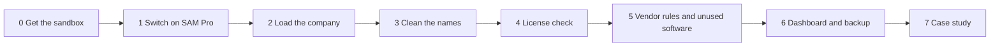

# Software Asset Management on ServiceNow: a working case study

We are building a complete software license management solution on ServiceNow, in a free sandbox with an invented company, to show how it finds audit risks and wasted license spend.

| | |
| --- | --- |
| **Status** | Started on 15 October 2026. Live progress: [tracker/TRACKER.md](tracker/TRACKER.md) |
| **Platform** | ServiceNow, Zurich release, Software Asset Management Professional |
| **Effort** | 8 stages in one or two working sessions a week, about 4 to 7 weeks |
| **Risk to the company** | None. A free personal sandbox and invented data only |

## Why this matters

Every company pays for software licenses, and few can say exactly what is installed and what they own. That gap costs money in two ways:

- **Audit risk.** Using more than you bought leads to back-payments when a vendor audits you.
- **Waste.** Paying for licenses that nobody uses.

ServiceNow Software Asset Management Professional compares what is installed with what was bought, automatically, and shows both.

## What the case study will show

Northstar Manufacturing is an invented company with 60 employees, 45 laptops and 12 servers. Five of its products cover every kind of result:

| Product | What the system will show | Business value |
| --- | --- | --- |
| Adobe Acrobat Pro | 40 licenses for 40 users: compliant | Renewal date tracked |
| Microsoft SQL Server | 24 processor cores in use, 16 licensed: under-licensed | EUR 15,780 audit exposure found |
| Microsoft Visio | 60 licenses, 35 in use: over-licensed | EUR 14,475 of licenses to reuse |
| Microsoft Project | 12 of 28 installations unused for 90 days | EUR 12,708 can be reclaimed |
| Microsoft Windows Server | The vendor's minimum-core rules applied: compliant | A correct count where simple tools get it wrong |

All figures belong to the invented company. They show what the tool does, not real savings.

## How the work is organised

Each stage ends with checks, screenshots and a short session report, so progress is visible and every claim is proven.

## Where to find things

| I want to | Go to |
| --- | --- |
| Understand the topic, with no prior knowledge | [docs](docs/README.md) |
| See where the project stands | [tracker](tracker/TRACKER.md) |
| Do the work, step by step | [app](app/README.md): download and double-click `SAM_Pro_Build_Guide.html` |
| See the proof | [evidence](evidence/README.md) |
| Read the finished story | [docs/case_study.md](docs/case_study.md) |

## See it live

From Stage 7 the address of the sandbox and a read-only visitor login are listed here. Until then the progress lives in the tracker.

## Safety

Invented data only. No passwords, company data or real license keys are stored in this repository, and every upload is checked automatically for secrets.
