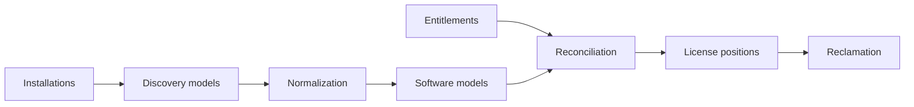

# How SAM Professional works

ServiceNow Software Asset Management Professional (SAM Pro) turns raw installation data into license results through a fixed chain. Our project builds that chain, one stage at a time.

## 1. Installations (Stage 2)

A scanning tool records every program on every computer. Each record says: this program, this version, on this computer. In a company the scan comes from ServiceNow Discovery, Microsoft SCCM or an agent. In our sandbox a script plays the scanner and creates 248 installations for the invented company.

## 2. Discovery models (Stage 2)

All installations with the same publisher, name and version are grouped into one discovery model. Our 248 installations form 8 discovery models, for example "Microsoft Visio Professional 2021, 16.0.14332.20637".

## 3. Normalization (Stage 3)

Scanners report names the way each program describes itself, which is messy: "Adobe Acrobat (64-bit)" with version "24.2.20857". Normalization turns this into a standard identity: publisher Adobe, product Acrobat, version 2024, edition Pro. SAM Pro does this with a content library of known software. Paid instances keep it current through the online Content Service; our sandbox uses the built-in library and manual cleaning.

## 4. Software models (Stage 3)

A software model is the product as we manage it for licensing, such as Microsoft Visio Professional. Its discovery map, shown on the model as the tab Matching Discovery Models, tells SAM which normalized installations belong to it.

## 5. Entitlements and allocations (Stage 4)

An entitlement records a purchase: product, quantity, license metric, price and dates. An allocation assigns a license to a named person or computer, for products licensed that way.

## 6. Reconciliation (Stage 4)

The license check. SAM compares what is installed and allocated with what was bought, using the license metric and the vendor's rules, and produces a license position per product: compliant, under-licensed or over-licensed, with the money involved.

## 7. Vendor rules (Stage 5)

Publisher packs hold each big vendor's rules. For Microsoft per-core licensing, for example, every server must be licensed for at least 16 cores even if it has fewer. A simple count gets this wrong; SAM Pro gets it right.

## 8. Reclamation (Stage 5)

SAM looks at usage data: when was each program last used? A reclamation rule, such as "not used for three months", turns unused installations into removal candidates. After approval the license goes back into the pool and is reused instead of bought again.

## The Software Asset Workspace

All of this is managed in one screen with views such as **License usage** (results per vendor and product) and **License operations** (entitlements, software models, discovery models, reclamation rules, removal candidates).
